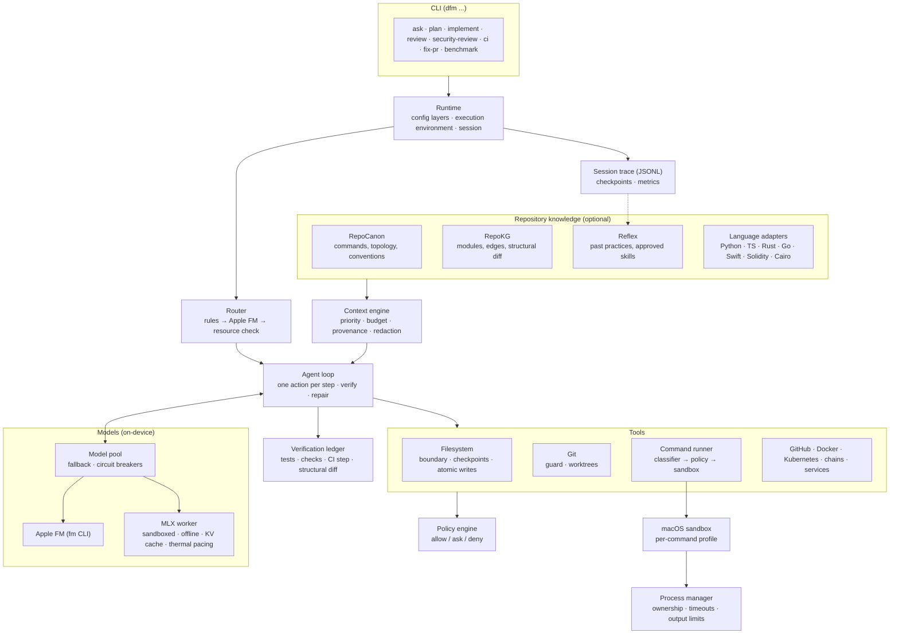
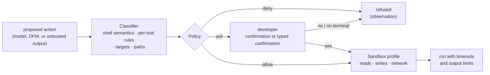

# Architecture

DFM is a local coding agent for Apple Silicon. A local model proposes actions; DFM executes them
through policy-checked tools and decides, from evidence, when the work is done.

Related: interfaces in [docs/architecture.md](docs/architecture.md), threats in
[docs/threat-model.md](docs/threat-model.md), rationale in [docs/decisions/](docs/decisions).

## Principles

1. **The orchestrator owns truth.** The model proposes one action at a time. DFM runs it,
   observes the result, and reports success only from commands that ran.
2. **Authority order.** User request > security policy > filesystem > compiler/tests/LSP > Git >
   RepoCanon > RepoKG > Reflex > repository docs > model output.
3. **Local inference only.** Remote inference is denied by policy, and no hosted-model SDK may be
   a dependency. Model networking and engineering networking are separate policies; `--offline`
   disables both.
4. **One source of truth per concern.** RepoCanon owns the repository model, RepoKG the code
   graph, Reflex the developer's history. DFM composes them.
5. **Degrade, except policy.** A missing integration or model reduces capability and is reported.
   It never relaxes a safety rule.
6. **Repository content is data.** Files, issues, CI logs and tool output reach the model as
   marked untrusted blocks, redacted, with provenance on every item.
7. **Bounded resource use.** Memory admission, thermal pacing, token budgets and prefix caching
   keep the agent from exhausting the machine.

## System overview



## Request flow

`dfm implement "fix the failing test"`:

```mermaid
sequenceDiagram
    participant U as Developer
    participant D as DFM (agent loop)
    participant C as Context engine
    participant M as Local model
    participant T as Tools + policy + sandbox

    U->>D: request
    D->>D: load config, open session trace
    D->>D: route: tools only, Apple FM, or coder (small or primary, memory permitting)
    D->>T: detect language, run baseline tests, start required services
    loop until done, give up, or budget exhausted
        D->>C: task, failures, focus files, diff, repository facts
        C-->>D: ranked, redacted context with provenance
        D->>M: cached prefix + history + current state, tools, reasoning level
        M-->>D: one action (read · search · patch · create · run · test · done · give_up)
        D->>T: execute through policy (ask the developer when required)
        T-->>D: observation (untrusted)
        D->>T: after an edit, rerun tests; on failure, repair at higher reasoning
    end
    D->>T: verify: tests, type check, lint, CI step, Git guard, structural diff
    D-->>U: report: changes, what was verified, what was not, risks
```

The report states only what the ledger records. Passing tests with a failing type check is
reported as `failed`, with the reason.

## Components

### Runtime and configuration

`Runtime.create` assembles one invocation: configuration, execution environment, process
manager, policy engine, session store, model pool, router and integration providers.

Configuration layers, in order: defaults, `~/.config/dfm/config.toml` (developer),
`<repo>/.dfm/config.toml` (untrusted: may only tighten policy and may not select models), CLI
flags. Reference: [docs/config.md](docs/config.md).

The execution environment defines the working directory, the filesystem boundary, a scrubbed
child environment (allowlisted variables, secrets removed), the network mode and resource
limits. The boundary covers the repository, DFM's state directories and approved paths. Key
stores, cloud credentials and browser profiles are always excluded.

### Router

Routing is deterministic first. Git and status questions are answered by tools without a model,
short text tasks go to Apple FM, and code tasks go to a coder whose tier (small or primary)
depends on the request. Apple FM breaks ties when the rules are inconclusive. A resource check
then substitutes the small coder if the primary does not fit in free memory and is not already
loaded. Each decision and its reasons are written to the session trace.

### Repository knowledge and context

| Source | Provides |
|---|---|
| [RepoCanon](https://github.com/NehharShah/repocanon) | test, build and lint commands; topology; conventions; boundaries |
| [RepoKG](https://github.com/NehharShah/repokg) | module neighbourhoods, blast radius, structural diff after edits |
| [Reflex](https://github.com/sumervaid/reflex-tui) (optional) | the developer's past practices and approved skills, marked historical |
| Language adapters | build, test and output parsing for Python, TypeScript, Rust, Go, Swift, Solidity, Cairo |

Providers are cached against freshness keys (Git HEAD, dirty-file fingerprint, tool versions)
and may be absent. The context engine collects candidates (referenced files, failures, the diff,
RepoKG modules, RepoCanon facts, Reflex practices, LSP results, related tests, neighbours, docs),
ranks them by fixed priority, fits them to a token budget, redacts secrets and records
provenance: source, path, lines, reason, time, content hash and confidence. Secret files keep
their keys and lose their values.

### Agent loop

Each step the coder chooses one action: `read`, `search`, `patch`, `create`, `run`, `test`,
`done` or `give_up`. DFM executes it with the same tools a developer's request would use.
Refusals, patch conflicts and test failures are returned as observations.

- **Prompt layout.** Stable content comes first, in separate messages: system instructions and
  tools, task and repository context, step history, then per-step state (diff, latest test
  result, step number). The worker caches everything before the last message.
- **Tool calls.** For models whose chat template supports tools, actions are passed as function
  definitions and the model replies in its native format (Qwen `<tool_call>`, gpt-oss harmony),
  which DFM translates. Other models receive a JSON schema.
- **Reasoning.** Steps request `medium` effort, and `high` after a failed edit, patch conflict or
  error. Each level has a thinking budget.
- **Compaction.** History is kept in full up to a size limit, then the oldest steps are reduced
  to one line each. History changes only at compaction, so the prefix cache stays valid.
- **Limits.** Tests rerun after each edit. A repair budget, no-progress detection, a step limit
  and a task token budget bound the loop.
- **Verification ledger.** At the end DFM runs tests, type check and lint, the CI step when
  reproducing CI, Git safety checks and a RepoKG structural diff. The final status is derived
  from the ledger alone.

### Models

All models implement one protocol (`healthcheck`, `generate`, `stream`). The model pool chains
them (primary, then small; Apple FM for light text) behind circuit breakers.

**Apple FM** runs through the `fm` CLI, restricted to the on-device `system` model.
Configuration that would enable Private Cloud Compute is rejected.

**Local coders** run in a separate MLX worker process per model, over JSON lines, so a crash or
out-of-memory kill does not take DFM down. The worker:

- runs in the macOS sandbox with Hugging Face offline mode, and never downloads;
- loads on first use, only if it fits in memory, and unloads when idle;
- samples with the model's recommended settings (`generation_config.json`), because greedy
  decoding causes repetition loops in reasoning models;
- stops a reply that has begun to loop;
- enforces the thinking budget by closing the model's thinking block and continuing from the
  same cache;
- snapshots the KV cache at each stable message boundary and reuses the longest matching
  prefix. The shortest snapshot (system prompt and tools) is saved to `~/.cache/dfm/kv/` so new
  sessions start warm;
- paces itself by macOS thermal pressure.

Output is normalized before parsing: reasoning blocks are removed, and native, markup and JSON
tool calls are translated to DFM actions. An unusable reply is retried once with the reason.

### Tools

- **Filesystem.** Paths are resolved against the boundary (case-insensitively on macOS). Git
  internals are never written directly. Edits are search/replace or unified diffs, never
  whole-file rewrites. Writes are atomic, preserve file modes and non-UTF-8 bytes, and are
  checkpointed. A file changed while an approval prompt was open is not overwritten.
- **Git.** The guard protects uncommitted work and refuses history rewrites. Large tasks can run
  in a separate worktree and return a patch.
- **Commands.** Every command is classified, authorized, sandboxed, and run by the process
  manager with timeouts, output limits and ownership records. DFM stops only processes it
  started.
- **Integrations.** GitHub, Docker and Compose, Kubernetes, blockchain toolchains (Foundry, Cast,
  Anvil), local services and log inspection use the same runner and policy.

## Safety model



- **Classification.** Commands are parsed with shell semantics (pipes, redirects, `&&`,
  `bash -c`, `env -S`). Each part is classified by a per-tool rule into an action class, from
  `SAFE_READ` to `PRIVILEGED` and `UNKNOWN`. Rules account for options that execute code (`rg
  --pre`, `sed e`, `git -c core.fsmonitor=…`, `tar -I`), every remote target (URLs, database
  hosts, connection strings), and Kubernetes contexts and chain targets from flags and
  environment. Commands with shell operators run through `/bin/sh`, matching how they were
  classified. A compound command takes the class of its most dangerous part. `UNKNOWN` is never
  treated as safe.
- **Policy.** Each action class and network category maps to allow, ask or deny. Destructive,
  privileged, production-cluster and mainnet actions require a typed confirmation of the target.
  Without a terminal, ask means deny. Actions proposed from untrusted output (for example a
  package name printed by a test) always ask. Model text in prompts is shown literally.
- **Sandbox.** Every command, including the model worker, runs under a per-run `sandbox-exec`
  profile. Reads are denied in key stores, cloud credentials, keychains, wallets and browser
  profiles. Writes are allowed only in the repository, temp directories and toolchain caches,
  and never in DFM's configuration or state, Git hooks or Git config. Network is denied unless
  every part of the command was approved for a network category. Inside an existing sandbox,
  DFM relies on the outer one, because macOS cannot nest them.
- **Secrets.** Everything sent to a model, trace, log or prompt is redacted: known token formats,
  high-entropy values, key/value pairs, command-line passwords and secret files in diffs. A write
  containing a redaction marker is refused.
- **Git hardening.** DFM's own Git processes run with `core.fsmonitor=false`, so repository
  configuration cannot execute code when DFM reads status.

## Resource controls

| Concern | Control |
|---|---|
| Memory | Before loading, weights, KV cache at target context, snapshots and overhead must fit in free memory less a reserve. Otherwise DFM reduces context, falls back to the small coder, or refuses with the numbers. |
| Heat | Every 32 tokens the worker reads thermal pressure. At the limit (`models.thermal_limit`, default `moderate`) it pauses for as long as it just worked, and longer when hotter. Benchmarks pause between runs. |
| Tokens | Recommended sampling, loop cutoff, per-step reasoning effort, thinking budgets, task token budget, native tool calls. |
| Repeated work | KV snapshots reused across steps and persisted across sessions; Reflex answers cached per session; integration caches keyed on freshness. |

## Modes

| Command | Behaviour |
|---|---|
| `dfm ask` | answers questions from tools and repository knowledge |
| `dfm plan` | proposes a plan without changes; tests run only in a read-only sandbox |
| `dfm implement` | runs the agent loop on the working tree, or in a worktree with `--worktree` |
| `dfm resume` | continues an interrupted session from checkpoints |
| `dfm review`, `dfm security-review` | deterministic checks, structural impact and verified findings on a diff |
| `dfm ci` | reproduces a failed GitHub Actions step locally and fixes it |
| `dfm fix-pr`, `dfm review-pr`, `dfm implement-issue` | GitHub-driven work in a worktree, returned as a patch |
| `dfm benchmark` | fixture tasks under integration ablations, with model attribution and seeds |
| `dfm doctor`, `setup`, `models` | machine checks, model discovery, memory estimates |

Reference: [docs/cli.md](docs/cli.md).

## Sessions and recovery

Each session writes a versioned JSONL trace: a header, then typed events (requests, routing,
context, model calls, commands, patches, verification, policy decisions), redacted before
writing ([schema](docs/protocol/dfm-session-v1.schema.json)). Reflex can learn from these traces.
Each loop stage is checkpointed with the original content of every file it touched, so
`dfm resume` can continue and a session can be undone. Per-session metrics (latency, tokens,
cached tokens, memory peak, thermal rest, tool calls, repairs) are available through
`dfm profile`.

## Storage

```text
~/.config/dfm/config.toml                     developer configuration (XDG paths honoured)
~/.local/share/dfm/sessions/                  session traces (JSONL)
~/.local/share/dfm/{logs,metrics,processes}/  logs, metrics, process ownership records
~/.local/share/dfm/cache/                     integration caches
~/.cache/dfm/kv/                              persisted KV cache, one file per model, mode 0600
<repo>/.dfm/config.toml                       repository configuration (tighten-only)
<repo>/.dfm/checkpoints/<session>/            checkpoints (listed in .git/info/exclude)
```

## Degradation

| Unavailable | Behaviour |
|---|---|
| RepoCanon | commands discovered from manifests and language adapters |
| RepoKG | LSP and text search; structural diff skipped and reported |
| Reflex | no historical practices |
| Apple FM | deterministic routing; the local coder handles short text |
| Memory for the primary coder | reduced context, then the small coder, then a reported refusal |
| Sandbox | environment scrubbing only, with a `doctor` warning, or the outer sandbox |
| GitHub | cached issue, PR and CI data, marked stale |
| Interactive terminal | ask resolves to deny; blocked actions are reported |

## Package layout (`dfm/`)

```text
cli/            Typer commands
orchestration/  runtime, agent loop, modes (ask, plan, implement, review, ci, github, resume)
routing/        routes and router
models/         Model protocol, pool, structured output, apple/, mlx/ (worker, discovery,
                output translation), resources (memory admission), thermal
context/        context engine and budgets
provenance/     context items and provenance
repository/     repository intelligence and freshness
integrations/   repocanon/, repokg/, reflex/, github/
tools/          filesystem/, git/, shell/ (classifier, rules, runner), languages/, github/,
                docker/, kubernetes/, blockchain/, packages, logs
lsp/            language server client
execution/      execution environment and filesystem boundary
processes/      process manager and registry
services/       local service lifecycle
policy/         action classes, network categories, decisions, approvals
security/       sandbox, prompt-injection handling
secrets/        detection and redaction
sessions/       session store and trace protocol
recovery/       checkpoints and resume
observability/  logs and metrics
benchmark/      tasks and runner
doctor/, config/, ci/
```

## Invariants

1. No hosted inference at runtime and no hosted-model SDK in dependencies.
2. Policy is enforced in the tool layer. Model output is never assumed safe.
3. DFM does not push, force-push, reset hard, clean, delete branches, rewrite history or
   overwrite unrelated work on its own.
4. Secrets do not enter model context, traces or logs.
5. Historical evidence (Reflex) is not presented as current repository fact.
6. Nothing is reported as verified unless a command verified it.
7. Every optional integration has a degraded path. Policy does not.
